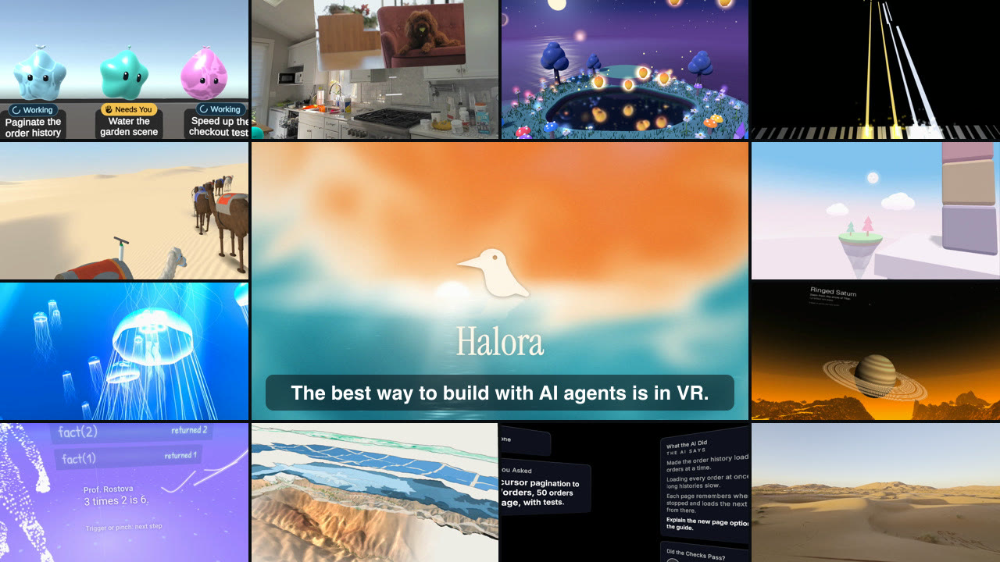
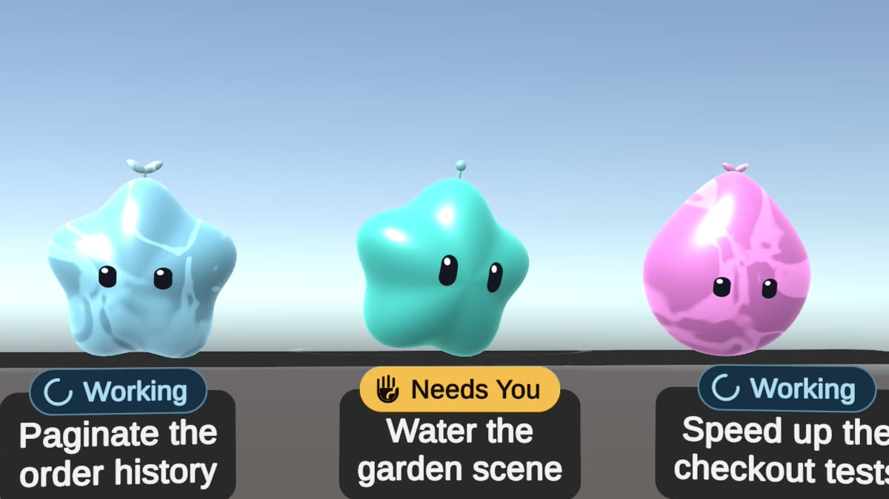
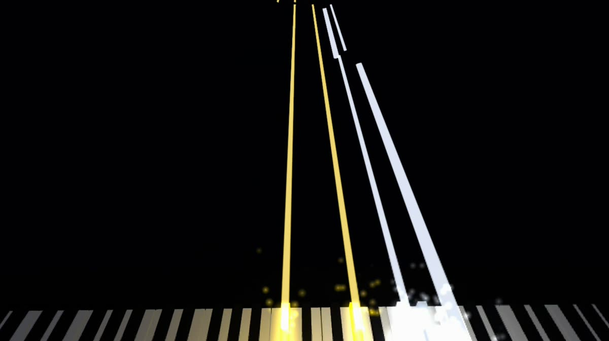
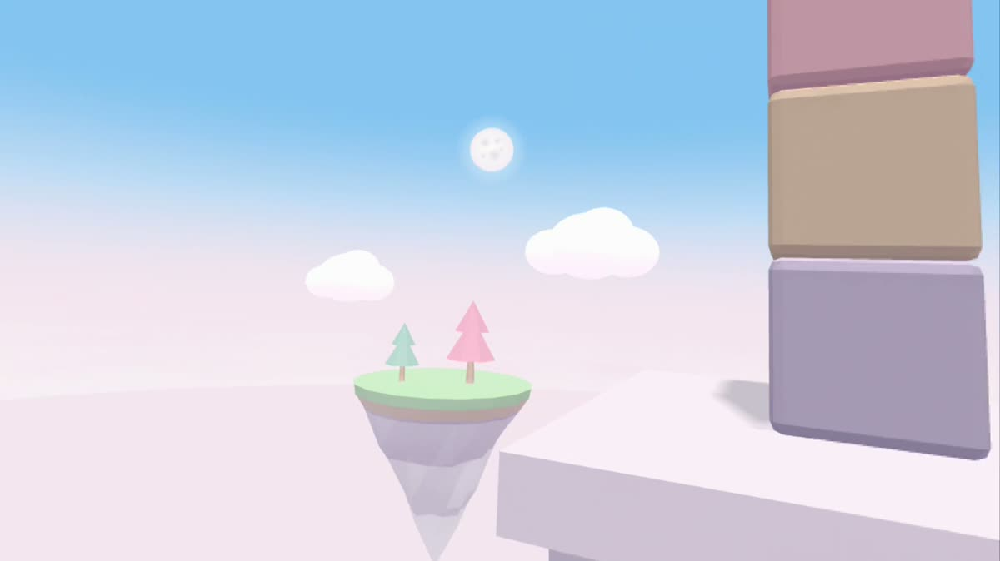

<p align="center">
  
</p>

<h1 align="center">Halora</h1>

<p align="center"><strong>The best way to build with AI agents is in VR.</strong></p>

<p align="center">
  <a href="https://youtu.be/Onu9mu5tyI4">Watch the film</a> ·
  <a href="#getting-started">Getting started</a> ·
  <a href="docs/internal/README.md">Documentation</a>
</p>

<p align="center">
  <a href="LICENSE"></a>
  <a href="package.json"></a>
  <a href="docs/internal/runbooks/XR_DEVELOPMENT.md"></a>
</p>

Building with AI agents today means a desk full of terminal windows. You lose track of which agent needs you and what each one did, and whatever they build stays on a flat screen.

Halora moves that work into VR. You put on a Meta Quest 3, and every project you're working on is in the room with you, each with its agents. You say what you want, watch the code get written, approve what needs approving, and step inside what you built.

<p align="center">
  <a href="https://youtu.be/Onu9mu5tyI4"></a>
</p>

## What you can do

- **Run many agents at once.** Each task is a small character standing at its project. You can see who is working and who is waiting on you without opening anything.
- **Talk to them.** Hold to talk, read your words back, and send. The agent works on your Mac while the files fill in in front of you.
- **Stay in control.** An agent can stop and ask before it runs a command. Each task works on its own copy, and nothing lands in your project until you add it.
- **See how the work was done.** Every run is laid out as a short story: what you asked, what the agent did and why, and whether it actually worked, measured rather than taken from the agent's word.
- **Build things you can step into.** Ask for a VR scene or game and play it in the headset as soon as it's ready.

<p align="center">
  
  
  
  
  
  
  
  
  
</p>

## How it works

Halora has two halves.

- **On your Mac**, a control plane (`apps/control-plane`, TypeScript on Node) runs the agents, keeps every change as an event in a local journal, builds and checks each task's copy, and talks to the headset.
- **On the headset**, a Unity app for Meta Quest 3 (`apps/xr`) shows your projects, tasks and agents in the room. It only ever talks to the control plane.

Agents plug in through one adapter interface, so the work stays the same whichever agent does it. Supported today: Claude Code, Codex, OpenCode, Cursor, Kiro and Antigravity. Each runs confined to its task's folder on macOS.

The deeper design lives in the docs: [system](docs/internal/architecture/SYSTEM.md), [domain model](docs/internal/architecture/DOMAIN_MODEL.md), [integrations](docs/internal/architecture/INTEGRATIONS.md), [security](docs/internal/architecture/SECURITY.md) and [XR client](docs/internal/architecture/XR_CLIENT.md).

## Getting started

You need a Mac with **Node.js 24.15 or newer** and **pnpm**. For the headset you also need a **Meta Quest 3** (or 3S); building the app from source uses **Unity 6000.3.25f1** with Android Build Support and the **.NET 10 SDK**.

```bash
pnpm install
pnpm dev          # start the control plane on 127.0.0.1:47800
pnpm mac-setup    # connect agents, voice and the headset
```

`pnpm check` runs the type check, lint and every test. To connect real agents and a headset, follow [local development](docs/internal/runbooks/LOCAL_DEVELOPMENT.md), [XR development](docs/internal/runbooks/XR_DEVELOPMENT.md) and [headset session](docs/internal/runbooks/HEADSET_SESSION.md). Contributors and coding agents start with [CONTRIBUTING.md](CONTRIBUTING.md) and [AGENTS.md](AGENTS.md).

## License

[Apache-2.0](LICENSE). Third-party fonts, SDK components and starter assets carry their own terms; see [NOTICE](NOTICE).
