<p align="center">
  
</p>

<h1 align="center">Halora</h1>

<p align="center"><strong>The best way to build with AI agents is in VR.</strong></p>

<p align="center">
  <a href="docs/internal/README.md">Documentation</a> ·
  <a href="docs/internal/product/PRODUCT.md">Product</a> ·
  <a href="docs/internal/architecture/SYSTEM.md">Architecture</a> ·
  <a href="docs/internal/runbooks/LOCAL_DEVELOPMENT.md">Local Setup</a> ·
  <a href="#getting-started">Getting Started</a>
</p>

<p align="center">
  <a href="LICENSE"></a>
  <a href="package.json"></a>
  <a href="apps/xr/dotnet"></a>
  <a href="docs/internal/runbooks/XR_DEVELOPMENT.md"></a>
</p>

Halora is a spatial VR environment for directing autonomous software work across projects and coding agents from Meta Quest 3, paired with a local control plane on macOS. Every project and task (`Workstream`) stands in space as a durable object while interchangeable agent runtimes (`Claude Code`, `Codex`, `OpenCode`, `Antigravity`, `Kiro`, and `Cursor`) execute inside confined folders, stream live code changes and literal approvals, and attach verified browser and test checks alongside session understanding and telemetry.

<p align="center">
  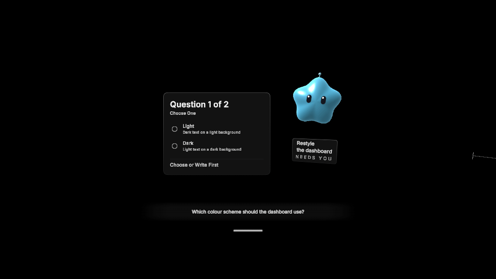
</p>

## See it in VR

<p align="center">
  <a href="https://youtu.be/Onu9mu5tyI4"></a>
  <br><a href="https://youtu.be/Onu9mu5tyI4"><strong>Watch the film (2:13)</strong></a>
</p>

| | |
| --- | --- |
|  | 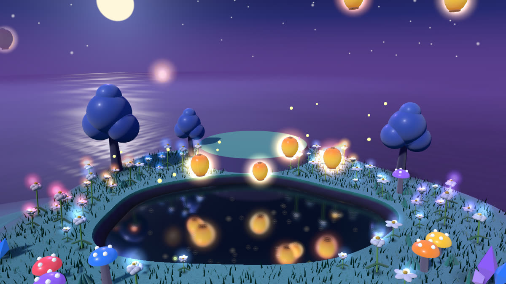 |
| **Every agent is a character.** Who is working and who needs you, at a glance. | **Three agents, one scene.** Each added a part at the same time; Halora landed all three together. |
|  | 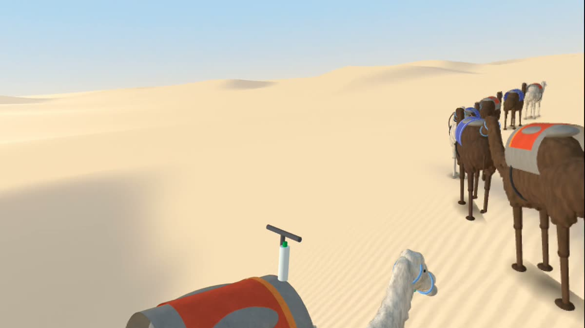 |
| **A piano of light**, made in Halora one request at a time. | **A camel ride I filmed in Morocco**, made into a place you can step into. |
|  |  |
| **Jellyfish Bloom**, made in Halora. | **Sky Tower**, a small game made in Halora. |
| 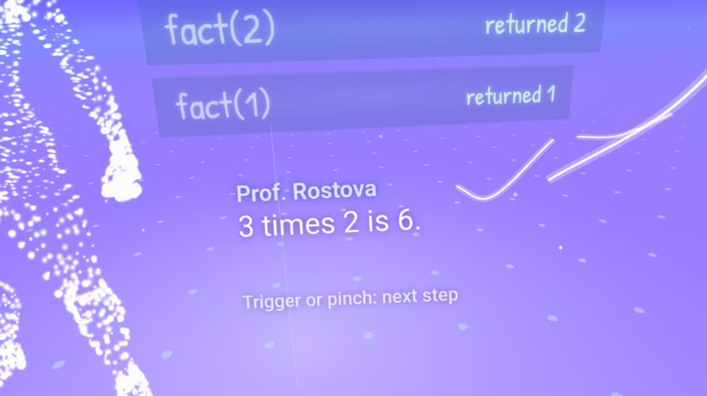 |  |
| **Equipped**, one of my own web apps, in VR. | **Albedian**, one of my own web apps, in VR. |
| 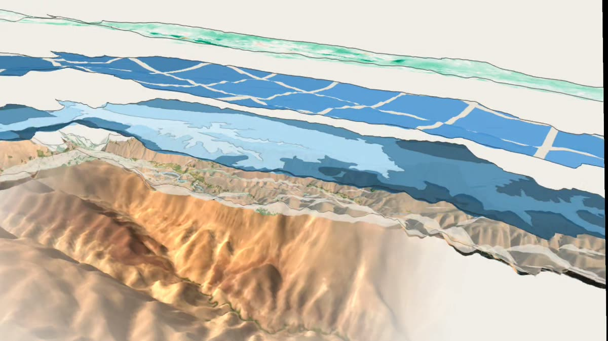 | |
| **Siterra**, one of my own web apps, in VR. | |

## Why Halora exists: four structural fault lines

Agentic coding tools, 3D engines, and verification harnesses currently sit in separate loops, leaving four structural gaps when directing autonomous software work:

| Fault line | What happens today | Why existing systems fail |
| --- | --- | --- |
| **1. Terminal session sprawl vs. durable work** | Developers run parallel tasks across terminal tabs, editor sidebars, and vendor CLIs (`Claude Code`, `Codex`, `OpenCode`, `Cursor`, `Antigravity`, `Kiro`). | Tying work to a single terminal window scatters history, approvals, and state whenever a session restarts or changes model. Flat 2D tab strips collapse once multiple tasks run concurrently across projects. |
| **2. Self-reported prose vs. verified outcomes** | Coding agents summarize their own turns in confident prose transcripts while leaving broken builds, untouched starter templates, or unverified edits. | Scrolling raw chat logs blurs the boundary between what an agent *reported*, what the host *observed* on disk, and what independent checks actually *measured*. |
| **3. Flat 2D loops for spatial and interactive software** | Building WebXR worlds, 3D scenes, or interactive apps inside a 2D code editor requires constant switching between terminal prompts, desktop browser tabs, and headset builds. | No shared working room places the directing controls, live file diffs, check results, and playable native WebXR output side by side. |
| **4. Broad local access vs. opaque permission prompts** | Local agent CLIs either inherit broad shell access to personal folders and credentials or interrupt work with raw permission walls. | Unstructured prompts hide control characters, working directories, and full file diffs, offering no path confinement or automatic Git rollback checkpoints. |

## Core primitives

Halora addresses these fault lines through five architectural primitives defined in the repository's [canonical documentation](docs/internal/README.md):

### 1. Software work as the object, runtimes as interchangeable executors

A character in VR represents a `Workstream`, never a vendor session ([domain model](docs/internal/architecture/DOMAIN_MODEL.md)). Work is organized as `Project -> Workstream -> Execution`, backed by an append-only SQLite event journal (`apps/control-plane`) and a deterministic state projection served over REST and WebSocket protocol v3 ([events](docs/internal/architecture/EVENTS.md), [realtime protocol](docs/internal/architecture/REALTIME.md)).
- **Pluggable `RuntimeAdapter` port (`packages/runtime-core`):** Vendor ids stay opaque references. Capabilities (`start_execution`, `instruct_at_rest`, `instruct_while_running`, `respond_to_approval`, `answer_question`, `interrupt`, `offers_plan`, `takes_pictures`, `offers_spending_cap`, `reports_usage`) are declared per runtime and never emulated ([integrations](docs/internal/architecture/INTEGRATIONS.md)).
- **Supported runtimes:** `Claude Code` (Agent SDK `0.3.283`), `OpenCode` (pinned `2.0.18`), `Codex` (pinned `0.157.0` on local Ollama models and gated Responses providers), ACP v1 agent apps (`Antigravity` `1.5.10`, `Kiro` `3.4.0`, and `Cursor` `2026.11.13`), and a deterministic `mock` runtime for labeled synthetic scenarios.

### 2. Epistemic provenance and read-through intelligence

Halora separates accepted commands from runtime-confirmed outcomes and labels how every fact is known:
- **Four provenance classes:** `observed` (verified directly by the host or runtime event), `reported` (stated by an agent, including closing sentences `Did`, `Why`, `How`, and `Left`), `inferred` (settled across a restart), and `unknown` (explicitly unavailable rather than guessed or defaulted to zero).
- **Read-through external intelligence:** Optional local integrations query [Salidium](docs/internal/validation/salidium-consumer-contract.md) for per-execution session understanding and briefs (`GET /api/executions/:id/understanding`, `/brief`), [Seorak](docs/internal/validation/seorak-integration-api.md) for session cost, outcome, verification, tool-mix, and cadence lenses plus account-wide provider usage limits (`GET /api/executions/:id/evaluation`, `GET /api/usage-limits`), and [Omnorium](docs/internal/validation/omnorium-catalog.md) for repository catalogs (`GET /api/catalog`). External readings are never written into the journal as host truth.

### 3. Spatial presence, neutral glass, and headset continuity

On Meta Quest 3 (`apps/xr`), projects with active work stand as places around the user in OpenXR ([XR client](docs/internal/architecture/XR_CLIENT.md), [visual style](docs/internal/product/STYLE.md)):
- **Embodied `Workstream` teams and multi-screen layout:** Each project place stands its active `Workstream` characters with readable status tags (`WORKING`, `NEEDS YOU`). Up to three project screens stay open at once around a seated user in dark neutral glass (`#121212`) that carries zero chrome hue, reserving color for character bodies, app content, and optional `Code Colours` syntax highlighting (`Halora`, `Plain`, `High Contrast`).
- **Voice direction and review before send:** `Hold to Talk` captures speech on the headset, transcribes it locally on the Mac with `whisper.cpp`, and can draft structured command proposals through a local Ollama or chosen hosted model. Every spoken or typed instruction stays editable on screen until confirmed with `Send Instruction`.
- **Native panel continuity and offline demonstration:** A native Android panel keeps waiting approvals, questions, and task status accessible when the immersive room is minimized. When no control plane is configured, the headset runs a labeled recorded demonstration through the same client pipeline.

### 4. Vetted WebXR starters, automated browser checks, and playable relays

New VR projects begin from the tracked Immersive Web SDK starter (`starters/iwsdk-vr`), sharing pinned read-only dependencies outside agent write scope:
- **Authored 3D starter worlds:** Includes `meadow`, `garden`, `seaside`, and `night` environments with CC0 Poly Haven skies and Quaternius nature models, browser-synthesized instruments and spatial light, mouse/keyboard and WebXR controller/hand input, personal photo/video reference support, and an automatic 72 Hz headset frame-rate guard.
- **Per-task copies and automated checks:** Parallel tasks work in isolated `workstream` copies that can be checked and previewed independently before combining into the project folder. Host checks run TypeScript, Vite, and a 10-second session in a Seatbelt-confined `chrome-headless-shell`, recording uncaught exceptions, pixel delta against the starter baseline, text legibility and panel fit at `1280x800`, WebAudio activity, and twin-clock input response, or running user-selected `package.json` scripts for existing repositories.
- **Headset and Mac play:** Passed builds stream to Quest Browser through per-screen TLS-backed loopback relays (`Play in Headset`, up to three simultaneous open project screens) or to a local Mac browser viewer (`Play on Computer`).

### 5. Confined execution, literal approvals, and Git checkpoints

Local execution is bounded by host-enforced controls on macOS ([security](docs/internal/architecture/SECURITY.md)):
- **Seatbelt confinement and host denials:** Supported runtimes run under closed-by-default macOS Seatbelt profiles that restrict writes to the execution's folder or task copy, block push and cloud credentials, and automatically deny requests reaching into sibling task copies or host data folders.
- **Literal approval wells:** Commands and tool inputs render in monospace with explicit host marks for line breaks (`↵`), tabs (`⇥`), edge spaces (`‹U+0020›`), and hidden or non-printable Unicode (`‹U+XXXX›`). Multi-part requests must be paged in full before `Confirm` becomes active, and requests exceeding `2,000` characters are denied automatically by the host with a structured reason.
- **Pair over Wi-Fi and undo with Git checkpoints:** Headsets pair over TLS 1.2+ using SRP-6a (`RFC 5054`) from a local browser page on the Mac (`Your Computer`). When `HALCYONIC_GIT_BIN` is set, the host records checkpoints before tasks, after turns, and before restores, verifying every restored file byte for byte.

## How it works

<table>
  <tr>
    <td width="50%" valign="top">
      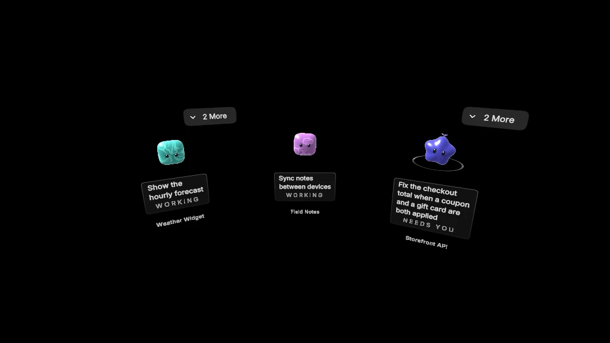
      <h3>1. See every project and task in space</h3>
      Active projects stand at distinct bearings around your seat. Each task is an embodied character whose plate shows its live state at a glance, gathering larger teams behind a count while keeping any task that needs your input in front.
      <p><a href="docs/internal/architecture/XR_CLIENT.md">XR client</a> · <a href="docs/internal/architecture/DOMAIN_MODEL.md">Domain model</a></p>
    </td>
    <td width="50%" valign="top">
      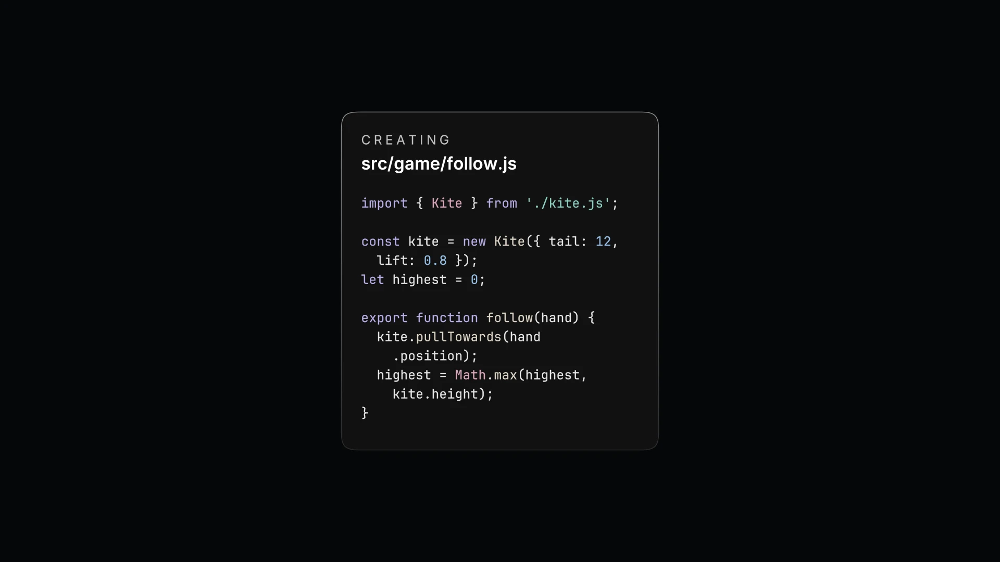
      <h3>2. Watch live code as agents build</h3>
      While a turn runs, <code>Watch It Work</code> streams changed files from the execution folder onto curved dark-glass panels with syntax highlighting in ten languages, withholding secret-shaped filenames and capping read rates on the host.
      <p><a href="docs/internal/product/STYLE.md">Visual style</a> · <a href="docs/internal/architecture/REALTIME.md#project-reads">Project reads</a></p>
    </td>
  </tr>
  <tr>
    <td width="50%" valign="top">
      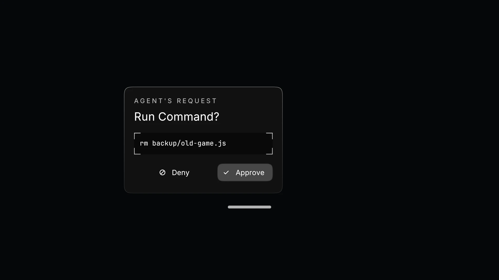
      <h3>3. Review literal commands and questions</h3>
      When an agent asks to run a command, use a tool, or clarify a design choice, its character flies beside the request panel. Commands appear in a literal monospace well with hidden characters marked and two-step confirmation before execution.
      <p><a href="docs/internal/architecture/SECURITY.md">Security boundaries</a> · <a href="docs/internal/product/WORDS.md">Interface copy</a></p>
    </td>
    <td width="50%" valign="top">
      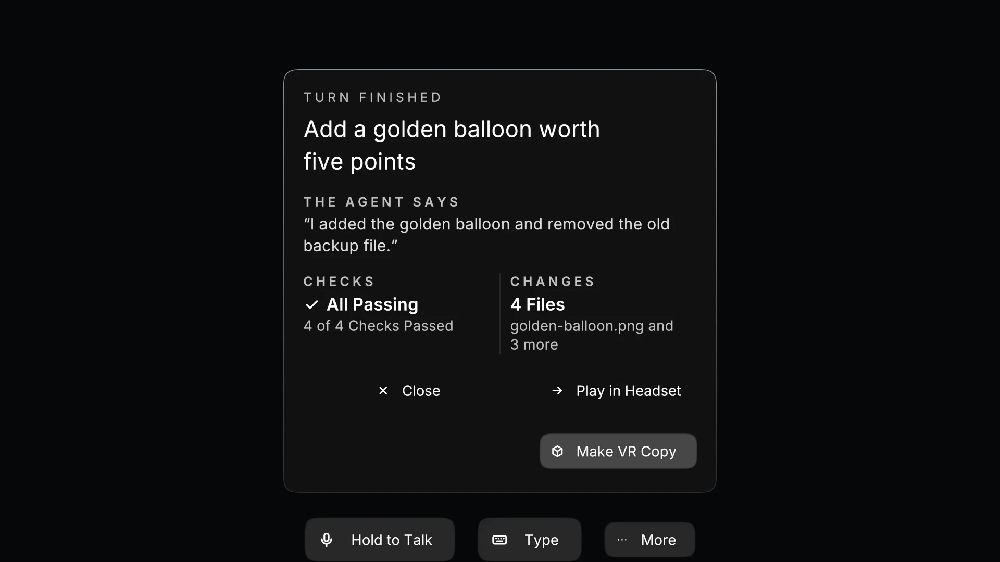
      <h3>4. Separate agent claims from checks</h3>
      Completed turns pair the agent's quoted closing summary (<code>reported</code>) directly beside host-verified check counts, changed file lists, spending caps, and one-press actions to play in the headset, make a VR copy, or restore a checkpoint.
      <p><a href="docs/internal/architecture/EVENTS.md">Event journal</a> · <a href="docs/internal/architecture/SYSTEM.md">Built slices</a></p>
    </td>
  </tr>
  <tr>
    <td width="50%" valign="top">
      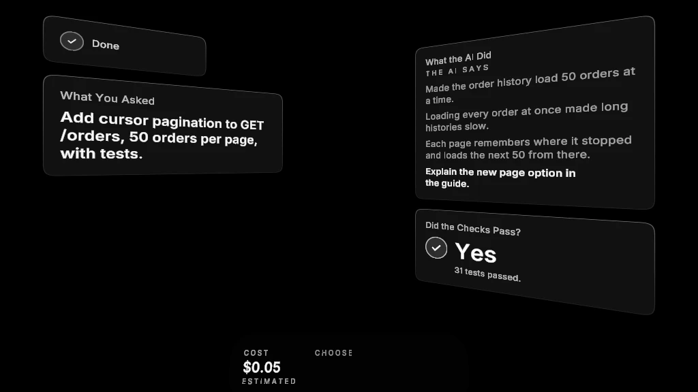
      <h3>5. Inspect reasoning and telemetry</h3>
      Opening <code>Reasoning</code> or <code>Outcome</code> on a project screen lays out what you asked, what the agent did, check results, Salidium session understanding, and Seorak cost, verification, tool-mix, and cadence metrics without polling.
      <p><a href="docs/internal/architecture/INTEGRATIONS.md">Integrations</a> · <a href="docs/internal/product/WORDS.md">Provenance &amp; copy</a></p>
    </td>
    <td width="50%" valign="top">
      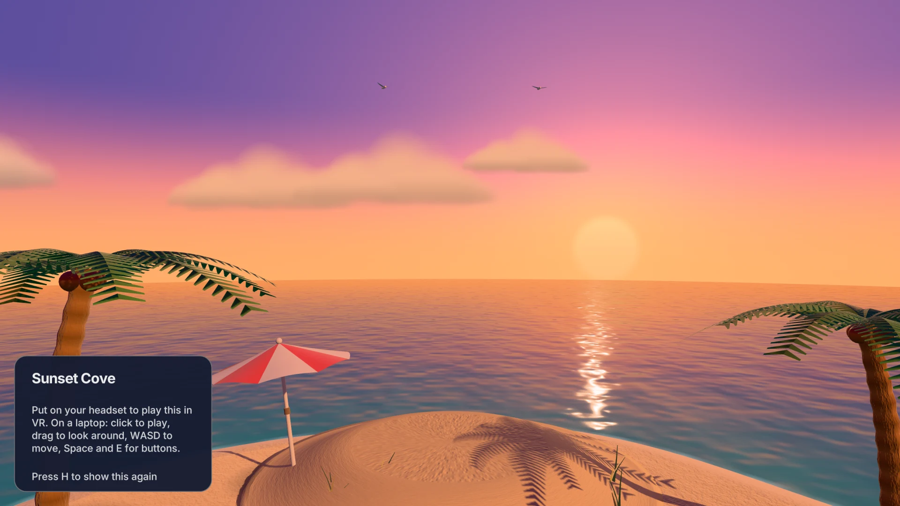
      <h3>6. Play checked WebXR output in VR or on Mac</h3>
      Projects built from the vetted WebXR starter are checked in headless Chrome and served over a paired relay to Quest Browser or streamed to a local Mac viewer, supporting both headset controllers/hands and desktop mouse/WASD controls.
      <p><a href="docs/internal/validation/iwsdk-starter.md">WebXR starter</a> · <a href="docs/internal/runbooks/HEADSET_SESSION.md">Headset session</a></p>
    </td>
  </tr>
</table>

## Capability boundaries

[PRODUCT.md](docs/internal/product/PRODUCT.md) states the long-term product vision; [SYSTEM.md](docs/internal/architecture/SYSTEM.md) inventories what this checkout implements today.

| Area | Implemented in this checkout | Product direction |
| --- | --- | --- |
| **Agent direction & runtimes** | `Claude Code`, `OpenCode`, `Codex` (local Ollama models and gated Responses providers), ACP v1 agent apps (`Antigravity`, `Kiro`, `Cursor`), and `mock`; start, steer/queue instructions, approvals, questions, plan mode, spending caps, image/video reference attachments, and session re-attach across restarts where supported | Attaching to arbitrary already-open terminal sessions and ChatGPT account sign-in for `Codex` |
| **Spatial workspace (Quest 3)** | Multi-project room places with embodied `Workstream` characters, up to three open project screens, neutral dark-glass UI, `Watch It Work` live syntax-highlighted code, `Hold to Talk` local Whisper voice + Ollama proposals, native Android multitasking panel, Wi-Fi SRP-6a TLS pairing, and bundled offline demonstration | Direct manipulation of arbitrary desktop IDE windows and cross-repository dependency maps in 3D space |
| **WebXR creation & checks** | Tracked `iwsdk-vr` and `world` starters, per-task `workstream` copies, combine/discard flows, Git checkpoints and verified restore, Seatbelt-confined headless Chrome verification (build, pixel delta, legibility, fit, audio, input), user-chosen `package.json` checks, Mac play viewer, Wi-Fi/public-tunnel sharing, and headset preview relays | Full spatial world-building inside custom light-layered `world.json` panoramas with bundled scene assets in release builds |
| **Understanding & telemetry** | Read-through Salidium (`understanding` v1.1 + `brief` v1.2), Seorak (`evaluation` outcome, verification, tool-mix, cadence + `usage-limits`), and Omnorium (`catalog` v1 with local git-origin matching), with explicit availability and provenance states | Live cross-repository project maps from Salidium and historical multi-session comparisons in VR |

## Architecture

Core packages (`contracts`, `domain`, `runtime-core`) have zero dependencies on runtime vendors, Salidium, Seorak, Omnorium, Unity, storage, or transport; `tooling/architecture.test.ts` enforces this boundary on every check. Wire contracts are defined once in TypeBox (`packages/contracts`) and generate both JSON Schema (`packages/contracts/schema/`) and C# bindings (`packages/contracts/csharp/`).

| Module | Location | Responsibility | Reference |
| --- | --- | --- | --- |
| **Contracts** | `packages/contracts` | Versioned TypeBox schemas for commands, events, views, REST payloads, and realtime protocol v3, plus generated JSON Schema and C# bindings | [Events](docs/internal/architecture/EVENTS.md) · [Realtime](docs/internal/architecture/REALTIME.md) |
| **Domain** | `packages/domain` | Pure projections, workstream attention rules, command admission, approval policies, and starter fix-step rules | [Domain model](docs/internal/architecture/DOMAIN_MODEL.md) |
| **Runtime core** | `packages/runtime-core` | `RuntimeAdapter` port, capability declarations, and vendor-neutral execution lifecycle types | [Integrations](docs/internal/architecture/INTEGRATIONS.md) |
| **Integrations & Seatbelt** | `packages/integrations/*`, `packages/seatbelt` | Adapters for `claude-code`, `opencode`, `codex`, `acp` (`antigravity`, `kiro`, `cursor`), `mock`, and read-through clients for `salidium`, `seorak`, and `omnorium`, plus macOS Seatbelt profiles | [Integrations](docs/internal/architecture/INTEGRATIONS.md) · [Security](docs/internal/architecture/SECURITY.md) |
| **Control plane** | `apps/control-plane` | Loopback and TLS network servers, SQLite event journal and projection checkpoints, SRP-6a headset pairing, `whisper.cpp` transcription, Git checkpoints, starter builds, and headless Chrome checks | [System](docs/internal/architecture/SYSTEM.md) · [Security](docs/internal/architecture/SECURITY.md) |
| **XR client** | `apps/xr` | Engine-independent C# client (`com.halcyonic.client`), Unity 6 OpenXR application for Meta Quest 3, and native Android panel (`apps/xr/android-panel`) | [XR client](docs/internal/architecture/XR_CLIENT.md) · [XR development](docs/internal/runbooks/XR_DEVELOPMENT.md) |
| **Starters & tooling** | `starters/*`, `tooling/*`, `fixtures/*` | Vetted `iwsdk-vr` WebXR starter and `world` scene starter, architectural/accessibility/ADB guards, and deterministic recorded traces | [Starter validation](docs/internal/validation/iwsdk-starter.md) · [Contributing](CONTRIBUTING.md) |

## Getting started

### Requirements

- **Headset:** Meta Quest 3 (or Quest 3S) for the VR workspace. Building the APK from source uses **Unity `6000.3.25f1`** with Android Build Support and the **.NET 10 SDK** ([XR development runbook](docs/internal/runbooks/XR_DEVELOPMENT.md)).
- **Host computer:** A Mac running **macOS** for the control plane, Seatbelt execution sandboxing, local `whisper.cpp` voice transcription, and headless Chrome app checks. (Linux can run the core Node control plane without macOS Seatbelt profiles; Windows is untested.)
- **Toolchain:** **Node.js `24.15` or newer** (runs TypeScript sources directly and uses `node:sqlite`) and **pnpm** (`package.json` pins `pnpm@11.27.1` via `packageManager`; `pnpm` 10+ switches to that pin automatically).
- **Check prerequisites:** `pnpm check` compiles the Android glance/panel tests and requires a JDK plus `android.jar` (supplied automatically by Unity `6000.3.25f1` Android Build Support, or via `JAVA_HOME` and `ANDROID_JAR`).

### Quick start

Install dependencies and run the control plane on loopback (`127.0.0.1:47800`):

```bash
pnpm install          # uses the pnpm version pinned in packageManager
pnpm dev              # run the local control plane on 127.0.0.1:47800
pnpm demo             # second terminal: drive the running control plane through the realtime protocol
```

Replay a recorded multi-workstream trace or configure real runtimes, voice, and headset pairing on your Mac:

```bash
pnpm replay fixtures/traces/multiple_workstreams.jsonl
pnpm mac-setup        # interactive Mac setup for runtimes, WebXR starter deps, voice, and pairing
```

Development and verification commands from [AGENTS.md](AGENTS.md):

```bash
pnpm check            # typecheck + lint + all Node/tooling tests
pnpm typecheck        # TypeScript 7 type checking only (Node runs .ts sources directly)
pnpm lint             # Biome check
pnpm format           # Biome format (writes changes)
pnpm test             # node:test across all workspace packages
pnpm test:csharp      # C# contracts and XR client core on .NET 10 against a real control plane
pnpm contracts:emit   # regenerate JSON Schema and C# bindings after contract changes
pnpm fixtures:record  # regenerate fixture traces after contract, pipeline, or scenario changes
```

To connect real coding agents (`Claude Code`, `OpenCode`, `Codex`, `Antigravity`, `Kiro`, `Cursor`), local Ollama models, `whisper.cpp` voice, Salidium, Seorak, or a Meta Quest 3 over USB or Wi-Fi, follow [Local development](docs/internal/runbooks/LOCAL_DEVELOPMENT.md), [XR development](docs/internal/runbooks/XR_DEVELOPMENT.md), and [Headset session](docs/internal/runbooks/HEADSET_SESSION.md).

## Documentation

| Start here | Go deeper |
| --- | --- |
| [Documentation map](docs/internal/README.md) | [Architecture decisions](docs/internal/decisions/README.md) · [Open questions](docs/internal/product/OPEN_QUESTIONS.md) |
| [Product intent](docs/internal/product/PRODUCT.md) | [Brand](docs/internal/product/BRAND.md) · [Visual style](docs/internal/product/STYLE.md) · [Interface words](docs/internal/product/WORDS.md) |
| [System inventory](docs/internal/architecture/SYSTEM.md) | [Domain model](docs/internal/architecture/DOMAIN_MODEL.md) · [Events](docs/internal/architecture/EVENTS.md) · [Realtime protocol](docs/internal/architecture/REALTIME.md) |
| [Runtime & intelligence integrations](docs/internal/architecture/INTEGRATIONS.md) | [Security boundaries](docs/internal/architecture/SECURITY.md) · [XR client architecture](docs/internal/architecture/XR_CLIENT.md) |
| [Local development runbook](docs/internal/runbooks/LOCAL_DEVELOPMENT.md) | [XR development runbook](docs/internal/runbooks/XR_DEVELOPMENT.md) · [Headset session runbook](docs/internal/runbooks/HEADSET_SESSION.md) |
| [Contributing guide](CONTRIBUTING.md) | [Agent contract](AGENTS.md) |

## License

[Apache-2.0](LICENSE). Third-party fonts, SDK components, and starter assets carry their own terms; see [NOTICE](NOTICE).

The headset client includes Material Symbols Rounded (Apache-2.0), Liberation Sans, Rajdhani, Archivo Expanded, Inter, and JetBrains Mono (SIL Open Font License 1.1), and Meta XR Audio SDK native libraries (Oculus SDK License Agreement). The `iwsdk-vr` starter includes skies derived from Poly Haven (Greg Zaal and Jarod Guest) and 3D nature models from Quaternius's Stylized Nature MegaKit under CC0 1.0.
